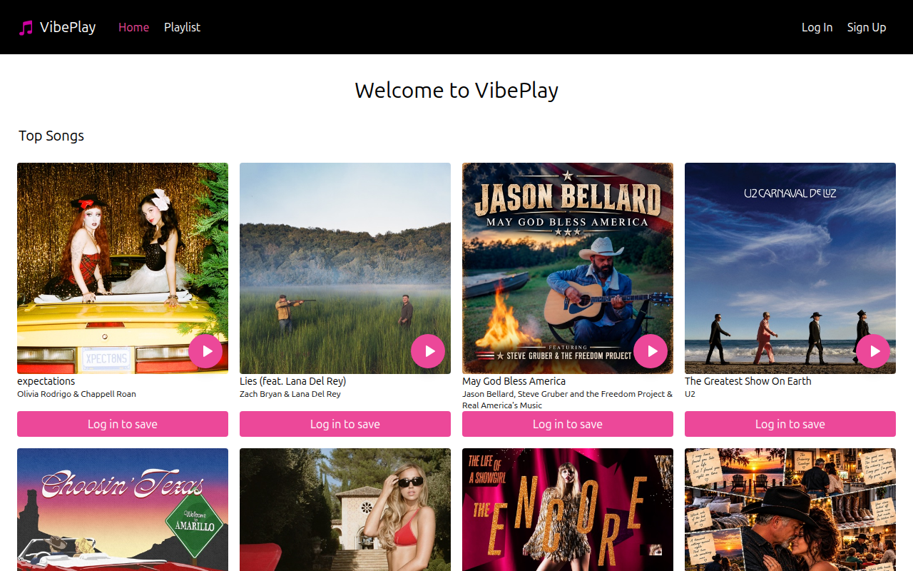

<div id="top"></div>

<div align="center">
  

  <h3 align="center">MyMusic</h3>

  <p align="center">
    A music player web app built with React and Tailwind CSS.
    <br />
    <a href="https://github.com/Cosmos0915/Music-Player"><strong>Explore the code on GitHub</strong></a>
  </p>
</div>

<details>
  <summary>Table of Contents</summary>
  <ol>
    <li><a href="#about-the-project">About The Project</a></li>
    <li><a href="#built-with">Built With</a></li>
    <li><a href="#getting-started">Getting Started</a></li>
    <li><a href="#environment-variables">Environment Variables</a></li>
    <li><a href="#available-scripts">Available Scripts</a></li>
    <li><a href="#notes">Notes</a></li>
  </ol>
</details>

## About The Project

**MyMusic** lets users sign up, log in, browse top tracks, and save songs to a personal playlist.

This repository contains the **React frontend**. User accounts and playlists are handled by a separate REST API (Node.js / Express / MongoDB), configured through environment variables.

**Pages**

- **Home** – welcome screen, or a grid of top tracks once logged in
- **Log In / Sign Up** – account forms
- **Playlist** – the user's saved tracks
- **Settings** – update or delete the account

<p align="right">(<a href="#top">back to top</a>)</p>

## Built With

- [React](https://reactjs.org/) 17 (Create React App + CRACO)
- [React Router](https://reactrouter.com/) 5
- [Tailwind CSS](https://tailwindcss.com/) 2

<p align="right">(<a href="#top">back to top</a>)</p>

## Getting Started

### Prerequisites

- [Node.js](https://nodejs.org/) and npm

### Installation

1. Clone the repo

   ```sh
   git clone https://github.com/Cosmos0915/Music-Player.git
   cd Music-Player
   ```

2. Install dependencies

   ```sh
   npm install
   ```

3. Create a `.env` file in the project root (see [Environment Variables](#environment-variables)).

4. Start the development server

   ```sh
   npm start
   ```

   The app opens at [http://localhost:3000](http://localhost:3000).

> **Node.js 17 or newer:** this project uses `react-scripts` 4, which needs the legacy OpenSSL provider on newer Node versions. If you see `ERR_OSSL_EVP_UNSUPPORTED`, run:
>
> ```sh
> NODE_OPTIONS=--openssl-legacy-provider npm start
> ```
>
> On Windows (PowerShell): `$env:NODE_OPTIONS="--openssl-legacy-provider"; npm start`

<p align="right">(<a href="#top">back to top</a>)</p>

## Environment Variables

| Variable                 | Description                                         | Example                  |
| ------------------------ | --------------------------------------------------- | ------------------------ |
| `REACT_APP_API_BASE_URL` | Base URL of the backend API                         | `http://localhost:5000`  |
| `REACT_APP_DOMAIN`       | Domain the auth cookie is set on                    | `localhost`              |

The backend is expected to provide these endpoints: `POST /user`, `POST /login`, `GET /token`, `PUT /update`, `DELETE /delete`, `GET`/`POST /music`, and `DELETE /delete_track`.

<p align="right">(<a href="#top">back to top</a>)</p>

## Available Scripts

| Command               | Description                                  |
| --------------------- | -------------------------------------------- |
| `npm start`           | Run the app in development mode              |
| `npm run build`       | Create a production build in `build/`        |
| `npm test`            | Run tests                                    |
| `npm run build:css`   | Compile Tailwind CSS to `src/styles/main.css` |

The included `netlify.toml` redirects all routes to `index.html`, so the app can be deployed to Netlify as a single-page app.

<p align="right">(<a href="#top">back to top</a>)</p>

## Notes

- Track data comes from the **Napster API** (`api.napster.com`), which is no longer available. The track grid on the home page will stay empty until the app is switched to another music API.

<p align="right">(<a href="#top">back to top</a>)</p>
